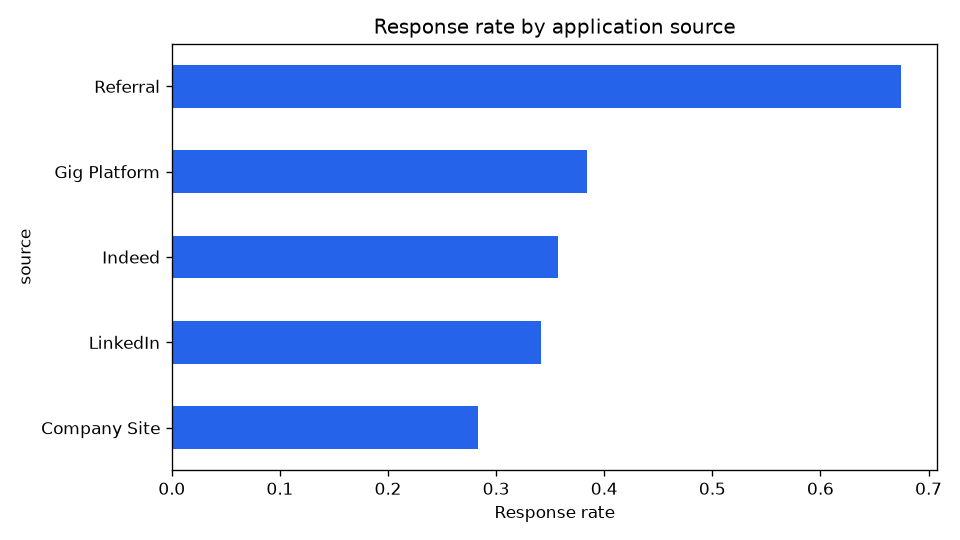
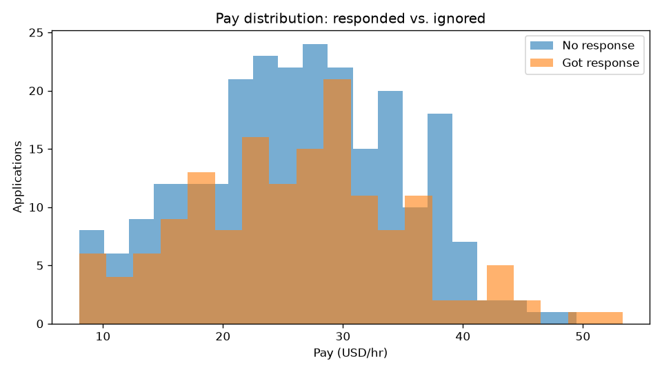

# AI Job-Funnel Analytics

A portfolio-ready Python project that turns a messy job-application export into
an analytics pipeline and a response-prediction model.

It demonstrates the core loop of AI data work:

**ingest → clean → store → feature engineering → descriptive analytics →
ML model → report.**

The domain is a job search funnel (applications, sources, response rates),
so every chart answers a question a job seeker or hiring analyst would ask.

## What's inside

- `src/jobfunnel/generate.py` — realistic synthetic application data (seeded)
- `src/jobfunnel/ingest.py` — CSV loading with schema validation
- `src/jobfunnel/clean.py` — dedupe, type fixes, median imputation
- `src/jobfunnel/store.py` — SQLite persistence (tiny warehouse)
- `src/jobfunnel/features.py` — leak-free feature engineering
- `src/jobfunnel/metrics.py` — funnel conversion and response-rate analysis
- `src/jobfunnel/model.py` — logistic regression response predictor
- `src/jobfunnel/report.py` — charts + Markdown report
- `src/jobfunnel/pipeline.py` — one-command end-to-end run
- `tests/` — pytest coverage for cleaning, features, and the model

## Quickstart

```bash
cd ai-job-funnel-analytics
python3 -m venv .venv
.venv/bin/pip install -r requirements.txt
.venv/bin/python -m jobfunnel.pipeline --generate --rows 400
.venv/bin/pytest
```

Outputs land in `outputs/`:

- `jobfunnel.db` — cleaned SQLite table
- `report.md` — funnel metrics, model scores, top predictors
- `response_by_source.png`, `pay_vs_response.png` — charts

## Sample run

```
Done.
  Applications: 400
  Response rate: 38.3%
  ROC-AUC: 0.556
  Report: outputs/report.md
```

(Numbers vary slightly with the seed and row count.)

### Sample output




## Talking points for interviews

- **Data engineering:** schema validation on ingest, idempotent cleaning,
  SQLite as the serving layer between raw data and analysis.
- **No leakage:** post-response columns (`days_to_response`, `stage`) are
  excluded from features — a deliberate modeling decision, tested.
- **Evaluation:** holdout split with accuracy, precision, recall, F1, ROC-AUC.
- **Communication:** the Markdown report is written for a non-technical
  reader; charts answer "where should I spend my effort?"

## Easy extensions

- Swap the synthetic CSV for a real export (same schema, no code changes).
- Add a FastAPI `/predict` endpoint serving the trained model.
- Track experiments with MLflow or weights & biases.
- Add a Streamlit dashboard over the SQLite database.
